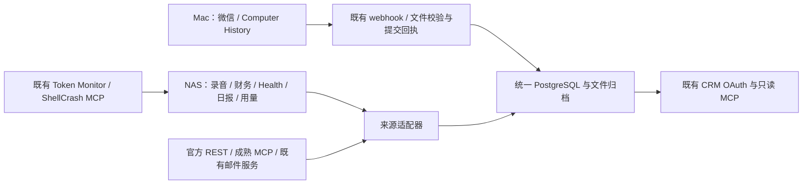

# Personal Data Hub

个人信息采集与聚合的统一仓库。第一阶段已实现公共采集基座、来源适配、统一归档和只读 MCP，并接管 NAS 上的运行入口。Mac 同步 Agent 在 `agents/mac` 管理；带信息查看界面的 Mac 客户端在 `apps/mac-client` 管理。

系统只采集、归档、聚合和查询。既有提醒、自动事实、复盘、投影、ASR 和模型任务已退出当前运行链路，源码保存在 `legacy/`。

## 架构



公共基座位于 `src/personal_data_hub`，统一处理来源注册、账户边界、时间、幂等身份、版本、附件、提交水位、来源锁、运行记录和删除墓碑。既有 CRM 负责兼容微信推送、原 MCP 查询与 OAuth；Token Monitor / ShellCrash 的独立 MCP 继续运行。

结构化数据存入现有 PostgreSQL 的独立数据库 `personal_data_hub`，原始载荷和标准化字段同时保存。原始 UI 事件含 NUL 时使用 PostgreSQL JSON 保留转义值。文件按 SHA-256 存在 `/vol1/1000/personal-data-hub/assets`，记录保留原名称、类型、字节数和内容哈希。设备配置、凭据、数据库和附件均在仓库外。

## 来源与边界

| 来源 | 接入方式 | 当前范围 / 节奏 | 删除信号 |
| --- | --- | --- | --- |
| CRM / 微信 | 保留现有 webhook，归档和 CRM 表同事务提交 | 全部本机可读单聊/群聊及源消息；保留身份和水位，推送即入库，15 分钟对账 | 显式删除及完整来源清单 |
| Computer History / Skysight | 现有授权 Node 读取应用组，SSH/rsync 交付并取得数据库提交回执 | 已闭合原始片段、官方 10min / 6h 摘要；15 分钟 | 显式删除；缓存过期不删除 |
| Plaud | 官方 MCP 下载的薄适配层，独立 SDK 环境 | 现有录音历史及既有产物；每小时同步最近 30 天，保留原始音频 | 源接口未提供可靠删除信号 |
| AutoAccounting | 官方已合入的 HTTPS 账单 Webhook；聚合端薄适配 | 历史账单已导入；新账单推送即入库 | 官方导出暂不提供删除信号；可选扩展未启用 |
| Health | 兼容原 `/health/import` 与 `/health/recent` | 历史快照及后续推送；缺失字段不补零 | 源接口未提供删除信号 |
| Hermes | 读取已有 cron 执行报告 | 历史完整导入；15 分钟归档新报告 | 显式删除；轮转不删除 |
| Google Calendar / Tasks | NAS 复用既有只读授权的官方 REST | 同账号自有日历最近 30 天起、未来默认 365 天，全部任务清单；每小时；primary 身份不变 | cancelled / deleted，完整任务清单对账 |
| 邮件 | 薄适配层调用现有邮件服务的只读函数 | 现有账户 INBOX、原筛选规则、最近 30 天起，正文和附件；每小时 | 当前只读接口不支持可靠删除对账 |
| Git | 既有 GitHub MCP | 当前账号提交记录、最近 30 天起；每小时 | 搜索缺失不判断删除 |
| Memos | SQLite backup 一致快照 | 当前用户全部状态、关系和附件；每小时 | 完整清单对账 |
| Mem0 | 既有 MCP | 全量分页读取；每小时 | 完整清单对账 |
| Token Monitor | 读取原多设备存储 | 历史和当天累计、设备时区、订阅配置；15 分钟 | 显式删除；历史窗口缩短不删除 |
| ShellCrash | 同一既有采集器，源码入口迁入本仓库 | 历史及小时累计流量、采集缺口；15 分钟 | 显式删除；保留窗口不删除 |
| 旧证据 / 旧复盘产物 | 仅归档历史文件 | 兼容保存历史，停用旧处理任务 | 显式删除 |

远端时间数据初始回填最近 30 天，随后从已保存窗口继续采集；本机历史、Memos 和 Mem0 完整导入。Google / 邮件 / Git 不创建替代业务 MCP。Favsync、钉钉和 Hermes Episode 不注册为本阶段采集来源。

## 仓库管理

- `src/personal_data_hub/`：公共基座、适配器、API、只读查询和迁移。
- `apps/crm/`：迁入的 CRM，保留 Git 历史及迁移时的工作区改动。
- `apps/usage-monitor/`：原独立用量 MCP，保留 Git 历史和原运行身份。
- `apps/mac-client/`：菜单栏个人信息中心、主题页、Google 官方编辑适配与快捷浮窗。
- `agents/mac/`：Skysight 同步代码、launchd 安装器和原配置快照。
- `agents/nas/`：ShellCrash 单一采集器及 Plaud 只同步入口。
- `collectors/plaud/`：只用于下载和归档的自有代码，不运行 ASR。
- `integrations/autoaccounting/`：官方协议版本及可选删除扩展。
- `legacy/`：旧处理业务源码，不自动运行。
- `deployment/`：镜像构建和 systemd 入口。

自有源码集中在本仓库维护。NAS / Mac 的旧 CRM、NAS 用量 MCP 和 Plaud 项目目录已移除，运行入口直接使用本仓库。Hermes 报告保留旧远端。NAS 运维仓库仅迁入个人信息相关脚本，其他运维代码继续独立管理；原运行数据和私有环境留在仓库外。来源版本和维护位置见 `integrations/source-origins.json`；迁移、运行文件和回退见 [源码管理](docs/source-management.md)。Android 上游见 `integrations/autoaccounting/upstream.lock.json`。

## 使用

```bash
uv sync --python 3.12 --no-dev
.venv/bin/hub status
.venv/bin/hub collect memos
.venv/bin/hub backfill google --since 2026-09-06T00:00:00Z
.venv/bin/hub reconcile memos
.venv/bin/hub serve-collectors
```

默认私有配置：`/home/yuwk/.config/personal-data-hub/config.json`；使用 `HUB_CONFIG` 或 `hub --config PATH` 指定其他配置。参考 `deployment/config.example.json`，其中没有生产凭据。`hub` 是维护 CLI；`personal-data-hub` 是 HTTP 服务入口。

生产入口沿用 `https://crm-home.172906573.xyz`，OAuth 身份、密钥、盐和持久卷继续使用原配置。新增只读工具：`list_data_sources`、`list_data_records`、`get_data_record`、`get_data_asset_info`、`read_data_asset`。联系人及日报查询继续可用，MCP 不开放数据写入。

`list_data_records` 与 `GET /api/v1/records` 默认只返回 ID、来源、类型、时间、标题（最多 160 字符）和摘要（最多 500 字符），附带 `total` / `next_offset`。完整正文、原始载荷及附件按 ID 从详情工具 / 接口读取；需要原列表完整字段时显式传 `include_content=true`。来源、类型、时间筛选及原分页参数继续可用。

来源状态的 `last_run` 表示本轮采集结果，`quality_warnings` 单独报告归档中的历史异常数量。Skysight 本轮发现无效片段时为 `partial` / `segment_invalid`；无新增异常的成功运行为 `ok`，历史无效文件仍保留并显示 `historical_segment_invalid` 提示。

API Bearer 与既有 OAuth 分开管理。上传附件后调用 `/api/v1/ingest`，只有文件校验和数据库提交成功才返回 `committed: true`。来源水位仅在整次采集完成后推进；失败后的重复执行按来源身份和内容哈希去重。

显式删除会清理当前记录、历史版本和无其他引用的附件，并保留仅含哈希、来源和时间的墓碑。墓碑拦截旧备份重放；CRM 同时清理兼容查询表并阻止已删除微信事件重放。失败、分页不完整、缓存轮转及时间窗口缩短不会被当作删除。

## Mac 客户端

`apps/mac-client` 打包为统一菜单栏应用，包含查看端、微信采集运行环境和电脑活动同步脚本；安装时迁移已有后台任务并注册登录启动。采集状态、水位和秘密保存在仓库外，Mac 采集代码从 Application Support 的版本目录运行。微信保留原已获准 Python 的真实路径作为启动入口，电脑活动保留原已授权的 Python / ChatGPT Node。安装包面向已有设备配置的 Mac。

默认进入今日概览，展示日程、健康和最近交流，可定制模块与指标。顶部切换数据趋势和最近动态，左侧进入日程任务、健康、社交、内容档案、财务用量。正文按需读取，支持完整导出、附件校验和录音播放。微信和电脑活动继续通过原 launchd label 采集；状态和同步操作放在侧栏底部。

归档查看凭据保存在 Mac Keychain，NAS 仅允许它读取信息。Google 编辑使用另一个 Keychain 项和独立浏览器授权，Mac 直连官方 API，NAS 按原周期归档，MCP 保持只读。全局 **⌃⌥Space** 呼出日程任务浮窗；任务日期不提供时刻或本地提醒。展示接口仅读取可重建的有界索引，不传输原始 AX 事件。安装和连接见 [客户端说明](apps/mac-client/README.md)，展示定义见 [Mac 信息展示](docs/mac-display.md)。

部署、回退和验证记录见 [部署说明](docs/deployment.md)、[第一阶段验收记录](docs/stage1-validation.md)、[第二阶段验证](docs/stage2-validation.md)、[列表和状态修正](docs/query-status-validation.md) 与 [展示改造验收](docs/mac-display-validation.md)。
