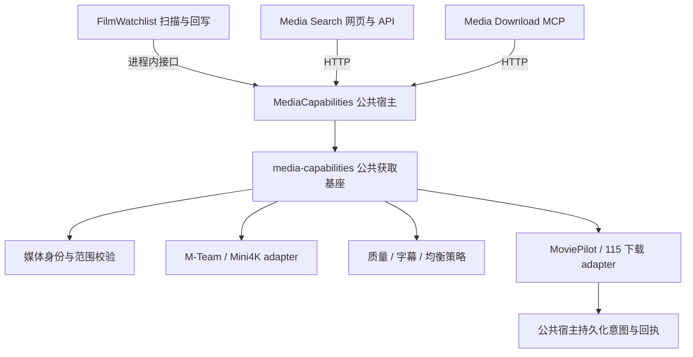

# 聚合查询与原子下载

FilmWatchlist、Media Search、Media Download MCP 各自维护业务骨架。
`MediaCapabilities` 是独立 MoviePilot 宿主插件，统一装配共享 wheel 中的获取能力。
网页和 MCP 不要求安装 FilmWatchlist；片单需要本次接入更新，后续各项目独立升级。



公共宿主只管理配置、HTTP 协议、运行时生命周期和存储入口；业务能力集中在
`packages/media-capabilities/src/media_capabilities/acquisition`。adapter 接收明确的
配置与工厂，不再读取 FilmWatchlist 实例或调用其私有方法。新服务不导入
MoviePilot 的 `app.*`，也不另存站点、115 或下载器密码。

## 安装与迁移

网页/MCP 部署只要求 MoviePilot 安装 **media-capabilities[acquisition] 0.3.2** 和
**MediaCapabilities 0.1.1**。使用片单时另将 FilmWatchlist 更新到 **1.4.3**。
MoviePilot 安装插件只复制插件目录，共享包必须先安装在宿主 Python 环境中。

当前 NAS 的实际入口、持久安装方式、备份及验证限制见
[2026-10-04 部署与迁移记录](media-acquisition-deployment-2026-10-04.md)。

```sh
# 在仓库根目录构建，复制 wheel 到 MoviePilot 的 Python 环境：
python3 -m pip wheel --no-deps --wheel-dir .build/wheels ./packages/media-capabilities
python3 -m pip install '/path/to/media_capabilities-0.3.2-py3-none-any.whl[acquisition]'
```

已有实例的迁移顺序：

1. 暂停旧片单扫描及新下载请求，保留已接收/结果不明的记录。
2. 安装共享包和独立公共宿主，使用片单时同时更新 FilmWatchlist；重启 MoviePilot，确保使用新共享包和插件代码。
3. 公共宿主首次初始化通过 MoviePilot 原生配置与数据接口补充读取旧配置、`acquisition_v1` 和片单提交记录，无需加载 FilmWatchlist。
4. 核对公共宿主的站点、路由和目录后打开“启用公共获取宿主”，切换网页/MCP 至新版本；最后恢复片单扫描。

迁移仅补充缺失项，已有新配置、新任务和资源登记优先保留；原数据不删除。
复制任务 ID、请求指纹、资源哈希和未确认提交，迁移过程不调用下载器。
迁移完成标记保存在公共宿主的 `migration_v1`，重复初始化不重新导入旧配置。
片单接入时也可补充登记自己的旧记录，以支持公共宿主先于片单安装的情况。
旧 115 分享没有资源哈希时用已保存候选引用保守去重。临时查询会话及候选引用需重新搜索。

三个入口共用 **MediaCapabilities 插件命名空间**中的 `acquisition_v1`。
FilmWatchlist 的 `records`、插件 ID、业务配置键、旧候选 ID 和恢复/回写流程保留。
原有 `public_*` API 保留兼容委托；其新增的 `acquisition_*` API 已迁至公共宿主。
FilmWatchlist 通过 MoviePilot 插件管理器取得同一个运行时，不使用 HTTP 回环。

公共配置统一维护站点 ID、Mini4K/Relay、115 路由和目录、分享开关及质量参数。
片单仍维护扫描、预览、Favsync、调度、身份提示和 `public_selection_enabled`。
原片单中旧公共配置键作为迁移输入保留，后续不再作为运行时配置来源。
浏览器会话与 Relay 文件默认继续使用历史的 `/config/filmwatchlist-*` 路径，名称
不表示运行依赖；可在公共宿主设置中指定路径，不复制或搬迁 Cookie。
磁力预检继续使用原 `/config/filmwatchlist-deps` 中的 libtorrent 环境。

Browser Relay 使用受保护的 Device ID 文件连接 Chrome，并复用已有的 Mini4K 标签。
远端没有 `/api/tabs/create` 接口；首次接入或更换设备后，需要在该 Chrome 打开并
保留一个已登录的 Mini4K 标签。不会自动导航其他网站的标签；已保存的标签关闭后，
仅重新选择 Mini4K 标签。设备离线或缺少标签时返回明确原因，不当作空搜索结果。

公共宿主默认关闭；`enabled` 控制新请求。公网 BT 默认走 115，
`p115_route_enabled` 默认开启，可用于暂停该路由；`share_115_enabled` 独立控制分享，默认关闭。
旧实例明确保存的关闭值仍会保留，不因软件升级擅自打开路由。片单的 `dry_run` 只影响片单业务。
宿主不可用时暂停新提交，不能自动退回私有执行器。停用后仍可读取已有下载回执；
重载使用相同提交登记和浏览器导航锁，已预留意图不因执行器替换而重新入队。
原片单复用回执时保留实际路由和目标目录，按原下载器恢复。
仍要求 **单个 MoviePilot API 工作进程**，不支持多进程并发写同一插件命名空间。

## 查询和下载范围

查询默认取各站首批结果，逐站返回，不获取种子或磁力元数据。网页按需加载更多；
成功查询缓存 5 分钟，明确空结果缓存 30 秒，同一进行中的查询合并。
Mini4K 详情页缓存 5 分钟，导航沿用受保护的串行浏览器传输；资源解析不使用详情缓存。
M-Team 使用 MoviePilot 的单站标题查询与分页，不执行全站聚合和逐资源媒体识别。

媒体不唯一或仅模糊匹配时返回 `needs_selection` 和 `choices`，用媒体 ID 明确选择。
身份识别无结果或上游异常时，只要提供片名，查询会按名称和可选年份直接检索两站，
返回 `identity_status=unverified` 和说明；未指定媒体类型时不强制限定为电影。
此兜底只用于查询，候选引用不会绕过下载身份校验；需用 TMDB/IMDb ID 重新搜索后下载。
只有已确认身份与季集清单才允许自动下载。

| 范围 | 请求 | 文件核验 |
|---|---|---|
| 电影 | `media_type=movie` | 一个 MKV/MP4 资源，拒绝原盘 |
| 指定季 | `scope=season, season=2` | 一个资源包含该季全部已知集数，不接受其他季代替 |
| 单集 | `scope=episode, season=2, episode=3` | 对应单集，不接受整季包或无法核实集序的视频 |
| 整剧 | `scope=series` | TMDB 声明已完结，正季和总集数一致，一个 BT 资源覆盖全部正季 |

剧集默认 `scope=season, season=1`。整剧不拼单、不接受 115 分享替代，不扩展为追更订阅。
新网页/MCP 不因媒体库已有作品而拒绝下载，不比较旧版、不主动删除旧版或迁移状态。
后续整理由 MoviePilot/115 既有配置负责，本服务只返回下载器状态。

## 下载策略

公共宿主的 `public_only`（“自动下载仅公网资源”）默认关闭。开启后：

- 网页和 MCP 自动下载只查询、核验公共 adapter 的候选，不查询 M-Team，不因公网失败回退 PT。
- FilmWatchlist 自动走公网选源，即使其 `public_selection_enabled` 未开启；不查询 PT，提交边界也阻止新的 PT 自动任务。
- 搜索页面仍可查看所有站点；用 `candidate_id` 手动指定的 PT 不受限制，继续走 MoviePilot 下载器。
- 已有 PT／115 回执、恢复与入库回写继续处理；仅限制新的自动选源，不撤销已接收任务。

公开 BT 仍必须核实 `private=false` 和文件覆盖后才能走 115；115 分享受独立开关控制。
仅公网模式与质量／字幕／均衡策略分别控制来源范围和资源偏好。

| policy | 行为 |
|---|---|
| `quality`（默认） | 保留既有档位及相近体积优先公网的规则 |
| `subtitle` | 优先明确中文字幕候选，同组按质量排序；不足时降级为均衡并说明 |
| `balanced` | 2160p 编码/WEB-DL 优先，回退 1080p；排除 Remux；电影 35 GiB、平均每集 8 GiB 上限 |

均衡上限通过公共宿主的 `balanced_movie_gib`、`balanced_episode_gib` 配置。同档优先较小视频体积，
再按可用性和稳定规则裁决；同档体积比较不代表视频画质已实测。
字幕证据分为 `source_claim`、`mediainfo`、`sidecar`、`unknown`，都不冒充实际轨道验证；
`MULTI` 本身不能证明中文字幕。

昂贵预检只在下载请求中发生。质量策略在已核实高档候选后跳过低档；同档仍核实后比较。
查询总预算 60 秒、候选预检批次预算 60 秒，每次磁力预检最多 25 秒；底层浏览器调用可能
继续处理，调用方等待上限是 120 秒，超时后保留任务 ID 续查，不伪报接收成功。
一个站点故障或分页未完成时从已核实候选选择，并返回不完整查询说明；原片单继续按既有暂停规则运行。

## 接口与回执

宿主前缀为 `/api/v1/plugin/MediaCapabilities`，全部使用 MoviePilot 的 Bearer 鉴权：

| 方法与路径 | 用途 |
|---|---|
| `POST /acquisition_search` | 请求正文为媒体查询；立即返回 session_id |
| `GET /acquisition_search_status?session_id=...` | 逐站结果、候选引用、首批与站点耗时 |
| `POST /acquisition_more` | 正文 `session_id`、`source_id`，继续读取一站分页 |
| `POST /acquisition_download` | 媒体查询或 candidate_id，等待提交回执 |
| `GET /acquisition_status?task_id=...` | 下载器状态和可用进度 |

下载请求可使用 `tmdb_id + media_type`、`imdb_id`、`title + 可选 year`，或搜索返回的
`candidate_id`。候选引用有效 15 分钟，下载范围必须与搜索一致；指定候选只执行范围和安全校验，
不应用自动选源偏好。返回中不包含原始下载链接、种子字节或会话凭据。

`request_id` 可由调用方提供；相同 ID 的不同参数会被拒绝。服务在提交之前保存意图，
相同 BT info-hash 或分享摘要复用已登记回执。响应丢失时保留 `pending`；查不到任务本身
不授权重新提交。宿主重启中断提交前处理时返回明确失败，提交中的记录继续保守对账。
115 分享结果不明时不会仅凭同名文件误报接收成功。

回执包括 `task_id`、`status`、`phase`、作品、范围、实际策略和路由、所选资源、
字幕证据、原因、warnings、逐站状态与 timing。`submitted` 表示下载器已接收，
`completed` 表示 115 下载完成；它们都不表示已入媒体库。`pending` 需按 task_id 续查。
PT 状态查询优先保留原有受理回执，任务消失不会导致重交。

## 基本冒烟

只使用假站点、假下载器和临时令牌，不运行完整回归：

```sh
PYTHONPATH=packages/media-capabilities/src:apps/media-search:apps/media-download-mcp \
  .build/acquisition-venv/bin/python tests/smoke_acquisition.py
PYTHONPATH=packages/media-capabilities/src:apps/media-search:apps/media-download-mcp \
  .build/acquisition-venv/bin/python tests/smoke_capability_host.py
PYTHONPATH=packages/media-capabilities/src .build/acquisition-venv/bin/python -c \
  "import sys; sys.path.insert(0,'tests'); import conftest, smoke_unified_workflow, smoke_legacy_submission"
```

基本冒烟覆盖范围、三种策略、延迟预检、缓存、站点故障、相同资源与请求去重、
丢失响应后的待核实状态、网页鉴权与 MCP 结构化回执。独立宿主冒烟证明不加载
FilmWatchlist 时两应用仍可查询和提交；重复迁移、跨入口复用实际路由，以及宿主
重载后不明提交继续保持 pending。安装版宿主配置/数据接口签名已只读核对。
真实站点搜索和指定资源的真实提交需部署后验收；本次开发不自动更新生产插件或触发真实下载。
