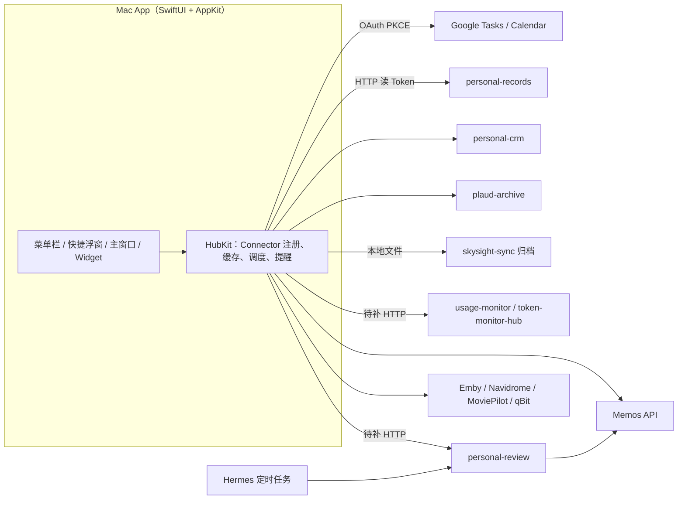

# 个人信息聚合中心：产品与架构 Brainstorm（2026-10-20）

> 本文是早期讨论记录。平台（Mac + 安卓）、后端、模块化布局等决定以 [`2026-10-20-requirements.md`](2026-10-20-requirements.md) 为准。

旧实现已归档到 `archive/v0`，仅在实现具体功能时参考代码，不作为架构参考。

## 1. 现状约束（调研结论）

| 事实 | 对新项目的影响 |
| --- | --- |
| 2026-10-19 NAS 旧 Hub 已退役：各采集应用独立运行，**不再有统一数据镜像或统一读取服务** | 新项目不重建中心库，做"客户端联邦读取" |
| `personal-records`（Health / 账单）、`plaud-archive`、`personal-crm` 都已提供 **HTTP + MCP**，HTTP 用读/写 Bearer Token | v2 直接读 HTTP，开发量小 |
| `skysight-sync` 无 HTTP 服务，归档在每台 Mac 本地 `~/.codex/skysight-sync` | Mac 端直接读本地文件 |
| Token / ShellCrash 流量：`usage-monitor-mcp` 只有 MCP（OAuth）；`token-monitor-hub` 有带认证的 `/api/stats` | 需要补一个只读 HTTP 口，或在客户端实现 MCP OAuth |
| Mac 本机 Clash Verge 流量采集器原本上传给旧 Hub，Hub 退役后**没有落点** | 需决定：放进新 App 本地采集，还是只看 NAS ShellCrash |
| 日报 / 周报 / 阶段 / 年度复盘由 `personal-review`（`reviewctl`）+ Hermes `lingjun` 定时任务完成，投递到 Telegram，终稿需用户确认 | v3 不重写生成逻辑，只做查看、确认、编辑入口 |
| `personal-review` 已有主线模型：`总主线` + 领域 `[关系, 身体, 财务, 生活, 事业]`，42 天周期、最多 5 个活跃目标，终态 `成功/失败/停止`；账本存 Memos，标签 `#日报 #周报 #主线 #阶段目标 #阶段总结 #年度总结` | "战略主线 / 阶段主线"直接复用这套模型，App 只做 UI |
| `personal-review` 目前只有 CLI，没有 HTTP | v3 需要给它加一个小 HTTP API（规则仍由它执行） |
| NAS 上已运行 Memos 0.30、Emby、Navidrome、MoviePilot、qBittorrent、IYUU、邮件 MCP（gmail1/gmail2/qq/wecom 只读） | 媒体和邮件都有现成数据源 |

## 2. 产品定位与形态

**一句话**：Mac 菜单栏里的"个人今日面板"——任务和日程秒开秒改，生活数据一眼可见，复盘与主线有归处。

三个交互面，按使用频率排序：

1. **全局快捷浮窗（最高频）**：`⌃⌥Space`（可配置）呼出，类 Spotlight。输入即新增任务（自然语言日期），`Tab` 切换"新增 / 搜索 / 今日"。回车即走，不抢焦点。
2. **菜单栏 Popover（高频）**：Today / Upcoming / All 三个 Tab，任务与日程合并时间线，可勾选、改期、移清单；v2 起追加"生活数据卡片"一行。
3. **主窗口（低频，深度使用）**：侧栏 `今日 / 任务 / 日程 / 生活数据 / 复盘与主线 / 媒体 / 设置`。关闭窗口后隐藏 Dock 图标，常驻菜单栏。

**菜单栏图标状态**（这是相比网页的核心价值）：

- 数字：今天到期 + 逾期任务数。
- 临近日程：15 分钟内有会议时显示 `14:30 会议名` 倒计时。
- 注意点（v2 起）：Token 额度 > 90%、健康数据断更、有待确认日报等，显示小红点，Popover 顶部列出原因。

## 3. 架构

### 3.1 原则

- **数据归属在来源**：每个来源自己负责存储、写入规则和认证；聚合中心是客户端，不复制业务数据。
- **统一接入契约**：每个来源对外提供"HTTP 只读口 + 只读 Token"（Agent 继续走 MCP）。缺 HTTP 的来源（usage-monitor、personal-review）在来源仓库补齐，而不是在本项目里加转发层。
- **本地缓存可丢弃**：客户端 SQLite 只做离线和秒开，删掉后能重新拉取。
- **Connector 插件化**：每个来源是一个 Connector，实现统一协议，新增来源不动主框架。

### 3.2 总览



### 3.3 Connector 协议（草案）

```swift
protocol Connector {
    var id: SourceID { get }
    func status() async -> SourceStatus            // 连接、最后更新时间、错误
    func todaySnapshot() async throws -> [Card]    // 菜单栏 / 首页卡片
    func attention() async -> [AttentionItem]      // 菜单栏红点与通知
    var quickActions: [QuickAction] { get }        // 快捷浮窗可调用的动作
    var refreshPolicy: RefreshPolicy { get }       // 轮询间隔、打开时刷新
}
```

### 3.4 技术选型

| 项 | 选择 | 理由 |
| --- | --- | --- |
| 客户端 | 原生 SwiftUI + AppKit（`NSStatusItem` + `NSPopover`） | 全局快捷键、动态菜单栏文字、WidgetKit、Keychain、低内存；后续可复用到 iOS。`MenuBarExtra` 对动态标题和 Popover 控制不够，主入口用 AppKit |
| 最低系统 | macOS 14 | `@Observable`、新版 SwiftUI |
| 全局快捷键 | `sindresorhus/KeyboardShortcuts`（MIT） | 基于 Carbon 热键，无需辅助功能权限，自带设置录制控件 |
| 本地缓存 | GRDB（SQLite） | 比 SwiftData 可控，便于做变更队列 |
| 工程 | XcodeGen + SwiftPM 本地包 `HubKit` | 工程文件可 diff；Widget 扩展需要 Xcode target |
| 凭据 | Keychain | 旧项目的固定签名经验可沿用 |

不选 Tauri / Electron：菜单栏 Popover、WidgetKit、内存占用都更差，且你已经有原生签名与 Keychain 的经验。

### 3.5 仓库结构（建议）

```text
apps/macos/            App target、Widget extension、XcodeGen project.yml
packages/HubKit/       Connector 协议、各来源 Connector、缓存、调度
docs/plans/            方案与验收记录
archive/v0/            旧实现，只读参考
```

NAS 侧的新增接口（usage-monitor 只读 HTTP、personal-review HTTP）放在各自仓库，不进本仓库。

## 4. 版本规划

### v1：Google Tasks / Calendar 桌面客户端

对标 KiteTasks 的体验，参考 TaskMenu（GPL-3，AppKit，可参考设计不直接拷贝代码）和 hot-cross-buns（SQLite 缓存 + 变更队列的离线模型）。

| 里程碑 | 内容 |
| --- | --- |
| M1.1 | OAuth（Desktop client + PKCE + loopback）、清单/任务增删改查、子任务、菜单栏 Popover、全局快捷新增 |
| M1.2 | Calendar 事件与任务合并时间线、Today / Upcoming / All、菜单栏数字与会议倒计时、本地到期提醒、跨清单全文搜索 |
| M1.3 | 离线缓存与变更队列、中文自然语言日期、清单颜色、看板视图；可选 WidgetKit |

**比 Kite 更好的点**：

- **任务时间块**：Tasks API 只有日期没有时间，可在新增时一键在 Calendar 建一个关联时间块，弥补 API 限制。
- **与复盘打通**：v3 的阶段目标已能投影到 Google Tasks，可在任务旁显示所属阶段目标。
- **中文 NLP**：KiteTasks 对中文只识别"明日"一类简单词；自写规则覆盖"下周五下午三点 / 月底 / 后天"。

**已知限制**（所有第三方客户端都受限）：Tasks API 的 `due` 只有日期、不支持重复任务、不能读写 Google 自己的提醒；Calendar 推送需要公网 HTTPS，桌面端用 `syncToken` 增量轮询（打开 Popover 时立即刷新 + 后台 5 分钟）。

### v2：生活数据聚合

| 卡片 | 来源 | 内容 | 写操作 |
| --- | --- | --- | --- |
| 健康 | records `/api/v1/health/*` | 今日步数、睡眠、静息心率，7/30 天趋势 | 无 |
| 账单 | records `/api/v1/bills*` | 今日支出、本月分类汇总、待确认数 | 可选：手动补记 |
| 人际 | crm `/api/v1/crm` | 最近交流、久未联系提醒 | 快速记一条交互 |
| 录音 | plaud `/api/v1/archives` | 当日转录稿、音频播放（支持 Range） | 无 |
| 电脑历史 | 本地 skysight 归档 | 今日 6h / 10min 摘要 | 无 |
| Token | usage-monitor / token-monitor-hub | 今日 Token、估算成本、各工具额度 | 无 |
| 网络 | ShellCrash（经 usage-monitor） | 今日上下行、策略组、节点 | 无 |

菜单栏注意点规则示例：额度 > 90%、健康数据超过 X 小时未更新、来源接口失败。

### v3：复盘、主线与 Memos

- **主线与阶段**：可视化 `总主线 → 五个领域 → 当前 42 天周期的 ≤5 个阶段目标`，显示剩余天数、关联任务、结案状态。新建、结案通过 personal-review 的 HTTP API，最多 5 个、周期长度、结案终态等规则仍由它校验。
- **日报 / 周报**：列出 Hermes 生成的草稿和已确认终稿（Memos `#日报` / `#周报`）；在 App 内查看、编辑、确认。确认流程要和 Telegram 二选一或定义优先级，避免双轨重复确认。
- **Memos 页面**：首版用 WKWebView 嵌入完整 Memos，再加一个原生的"按标签筛选报告"列表；快捷浮窗支持"记一条 Memo"。

## 5. 加分项

### 多平台邮件

- **完整复刻 Spark：建议搁置**。IMAP 同步、会话归并、HTML 安全渲染、撰写发送、Gmail OAuth、QQ 授权码、企业微信邮箱、推送，每一项都是长期维护负担，且现有邮件 MCP 是只读的。
- **轻量版：推荐做**。卡片显示各账户未读数 + Hermes 已有的 `work-email-brief` 摘要；点击跳转系统 Mail 或网页。需要给 email-mcp 补只读 HTTP 口，或复用 Hermes 的摘要输出。

### 媒体库入口

| 服务 | 接口 | 展示 |
| --- | --- | --- |
| Emby | REST + API Key：`/Users/{id}/Items/Latest`、`/Items/Resume` | 最近添加、继续观看 |
| Navidrome | Subsonic API：`getAlbumList2?type=newest|recent|frequent` | 最近添加、最近播放 |
| MoviePilot | v2 REST + Token | 订阅、下载中、推荐 |
| qBittorrent | WebUI API `/api/v2/transfer/info` | 实时速度、做种数 |
| PT 站 | 经 MoviePilot 站点统计或 IYUU | 上传量 / 分享率 |

只做列表和海报墙，点击跳转各自网页或原生播放器。

## 6. 可行性与维护难度

评分：★ 越多越难。

| 功能 | 可行性 | 开发量 | 维护难度 | 主要风险 |
| --- | --- | --- | --- | --- |
| Tasks 菜单栏 + 快捷键增删改查 | 高 | ★★★ | ★ | API 无时间/重复；OAuth 处于 Testing 状态时刷新令牌 7 天失效，需把同意屏幕发布为 In production |
| Calendar 展示与新建 | 高 | ★★ | ★ | 无 |
| 菜单栏数字 / 倒计时 / 通知 | 高 | ★ | ★ | 无 |
| 中文自然语言日期 | 高 | ★★ | ★ | 规则覆盖面 |
| 桌面 Widget | 中 | ★★ | ★★ | 需要 App Group 和正式签名团队；自签名可能不够 |
| Health / 账单 / CRM / Plaud | 高 | ★ 每个 | ★ | 来源接口已稳定 |
| Skysight 摘要 | 中高 | ★ | ★★ | 依赖 Codex 本地私有格式，客户端升级可能变化 |
| Token / 流量 | 中 | ★★ | ★★ | 需在 usage-monitor 补 HTTP 口；Mac 本机流量采集归属待定 |
| 主线 / 阶段 UI | 中 | ★★★ | ★★ | personal-review 需新增 HTTP API；业务规则多 |
| 日报 / 周报查看与确认 | 中 | ★★ | ★★ | 与 Telegram 确认流程的协调 |
| Memos 嵌入 | 高 | ★ | ★ | 无 |
| Spark 式完整邮件客户端 | 低 | ★★★★★ | ★★★★★ | 协议多、安全渲染、长期维护 |
| 邮件摘要卡片 | 高 | ★ | ★ | 依赖 email-mcp 补读口 |
| 媒体库入口 | 高 | ★★ | ★★ | MoviePilot 是本地改版镜像，接口可能随版本变化 |

## 7. 待确认

1. "这里要上 app" 是指 **iOS App**，还是 Mac 的完整主窗口？如果要 iOS，HubKit 从 v1 起就按多平台写。
2. Google 是单账号还是多账号？
3. 是否有（或打算开通）Apple Developer 账号？影响 Widget、公证和 iOS。
4. 离开家里局域网时，Mac 访问 NAS 服务走公网域名还是 Tailscale？目前只有部分服务有公网入口。
5. 日报确认以 App 为主还是继续以 Telegram 为主？
6. Mac 本机 Clash Verge 流量：是否需要在新 App 内重建采集？
