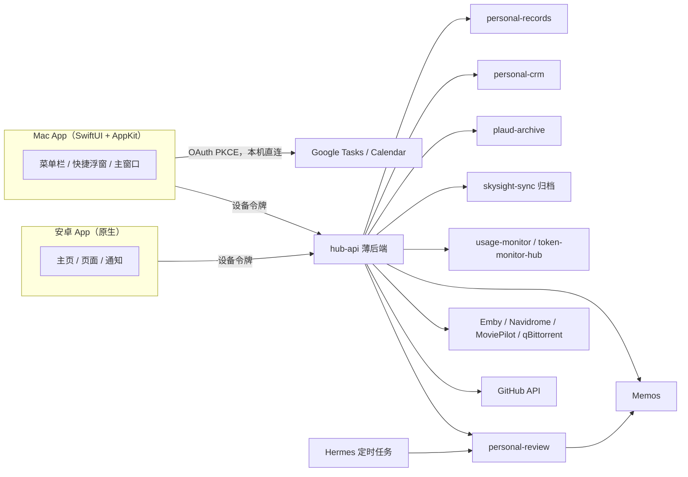

# Personal Hub 需求文档（2026-10-20）

本文档以讨论中已确认的决定为准，取代 [`2026-10-20-brainstorm.md`](2026-10-20-brainstorm.md) 中与之冲突的部分。视觉与交互以设计稿 [`docs/design/v1/index.html`](../design/v1/index.html) 为准。

## 1. 定位

个人信息的聚合管理中心：把分散在各个采集应用里的个人数据汇到一处，每天一眼看清；再基于这些信息定期复盘自己、设定主线和阶段目标。

- **看**：健康、账单、交流、媒体、Token、GitHub、网络、订阅、电脑历史、Memos。
- **做**：Mac 上秒开秒改 Google 任务和日程，随手记 Memo。
- **想**：主线与 42 天阶段目标、日报 / 周报 / 阶段结案，放在主页。

## 2. 已确认的决定

| 主题 | 决定 |
| --- | --- |
| 平台 | Mac + 安卓，两端能力相近；Mac 额外拥有 Google 任务 / 日程能力 |
| Google | 只在 Mac 端直连 Google Tasks / Calendar；后端和安卓都不接 Google。安卓用官方 Google Tasks（含语音） |
| 后端 | 有一个职责很薄的自建后端（见 §4）；不镜像业务数据，不重写报告生成 |
| 数据归属 | 数据留在各自来源（personal-records、personal-crm、plaud-archive、skysight-sync、usage-monitor、personal-review、Memos、媒体服务）；本项目只读取和展示，写操作调用来源自己的接口 |
| 组织方式 | 不按生活领域组织。每个数据源的展示层是一个**模块**，有简略版和详细版；页面只是模块的组合，后续支持自定义页面 |
| 任务与复盘 | 合并进主页，不单独成页 |
| 设计 | 参考 Anthropic 风格；Logo 为五段弧的"表盘"，无底板 |
| 旧项目 | 已归档到 `archive/v0`，只在实现具体功能时参考代码 |

## 3. 系统架构



### 3.1 组件

| 组件 | 技术 | 说明 |
| --- | --- | --- |
| Mac App | SwiftUI + AppKit，macOS 14+；`NSStatusItem` + `NSPopover`；Carbon 全局快捷键；Keychain；SwiftPM + 打包脚本（只需 Command Line Tools，不依赖 Xcode） | 菜单栏常驻，关闭主窗口后隐藏 Dock 图标；阶段 1 无第三方依赖 |
| 安卓 App | Kotlin + Jetpack Compose | 与 Mac 共用模块定义和布局配置；没有日程与任务模块 |
| hub-api | Python（FastAPI），部署在 NAS Docker，经 NPM + Authelia 暴露 | 与现有采集服务技术栈一致 |
| 本地缓存 | Mac：日程与任务缓存为单个 JSON 文件（`agenda.json`，0600，含离线变更队列）；安卓：Room | 只用于秒开和离线展示，删除后可重新拉取；数据量小，暂不引入 SQLite |

### 3.2 仓库结构

```text
apps/macos/                      Mac App（SwiftPM 包、Info.plist、scripts/ 构建签名安装测试）
apps/macos/Sources/HubKit/       纯逻辑：布局模型与存储、数据模型、示例数据（有单元测试）
apps/macos/Sources/PersonalHub/  App：AppKit 外壳、设计系统、模块视图
apps/android/        安卓 App（阶段 4 起）
services/hub-api/    薄后端（阶段 3 起）
docs/design/         设计稿
docs/plans/          需求、方案与验收记录
archive/v0/          旧实现，只读参考
```

来源侧缺的 HTTP 接口（usage-monitor、personal-review）在各自仓库补，不进本仓库。

## 4. 后端职责边界

**做**：

1. **统一认证**：Authelia OIDC 登录，给每台设备签发设备令牌，可单独吊销。
2. **代持来源凭据**：各来源的读写 Token、GitHub Token、媒体服务 API Key 只存在后端，客户端不接触。
3. **聚合接口**：按模块提供卡片数据、时间线、"需要注意"条目；只做转换和合并，不持久化业务数据。
4. **personal-review 前置**：把 personal-review 的查看、确认、结案能力以 HTTP 暴露给客户端（规则仍由 personal-review 执行）。
5. **推送**：安卓推送和 Mac 通知的统一触发（"需要注意"规则命中时）。
6. **偏好与布局同步**：页面布局、模块简 / 详选择、提醒阈值，在设备间同步。

**不做**：镜像或长期存储业务数据；重写日报 / 周报生成；接入 Google；代替来源校验写入规则。

**允许的存储**：设备与令牌表、布局与偏好、短期响应缓存（可丢弃）。

## 5. 模块

每个模块有统一结构：图标、标题、来源、更新时间；简略版固定高度 192px，用于拼贴；详细版按自身宽度自适应（容器查询 / 尺寸类）。

| 模块 | 来源 | 简略版 | 详细版 | 交互 / 写操作 | 平台 |
| --- | --- | --- | --- | --- | --- |
| 今日简报 | hub-api 聚合 | 问候 + 一句话摘要 | 可点击的摘要 + 快速输入栏 | 摘要高亮词跳到对应模块；输入栏新增任务或 Memo | 两端（安卓无任务输入） |
| 日程与任务 | Google Calendar / Tasks（Mac 直连） | 下一个日程 + 到期数 | 当日时间轴（当前时刻线）+ 逾期 / 今天 / 即将 + 快速新增 | 勾选完成、改期、编辑、中文自然语言新增 | 仅 Mac |
| 主线与复盘 | personal-review（经 hub-api）+ Memos | 主线 + 周期进度 + 待确认数 | 主线、42 天周期刻度、≤5 个阶段目标、日报 / 周报 / 阶段结案状态 | 查看并确认日报；查看目标进度 | 两端 |
| 需要注意 | hub-api 规则 | 横向提醒条 | 列表 | 点击跳转或处理 | 两端 |
| 健康 | personal-records | 步数环 + 睡眠 / 心率 + 14 天柱 | 今日指标、睡眠结构、14 天趋势 | 只读 | 两端 |
| 账单 | personal-records（AutoAccounting） | 今日支出 + 本月预算 | 今日明细、近期趋势、分类、资产账户 | 只读（后续可手动补记） | 两端 |
| 交流 | personal-crm + plaud-archive（录音为附件） | 今日交流人数 + 录音数 | 今日交流（含录音播放与转录）、本阶段统计、久未联系 | 快速记一条交流 | 两端 |
| 媒体 | Emby / Navidrome / MoviePilot / qBittorrent | 继续观看 + 下载状态 | 继续观看海报墙、最近添加、最近播放、下载、服务入口 | 点击跳转播放或网页 | 两端 |
| Token 用量 | usage-monitor / token-monitor-hub | 今日 Token + 成本 + 两条额度 | 日 / 周 / 月 / 年口径切换：总量、成本、环比、峰值、日均、热力图、按工具 / 设备；额度实时 | 切换口径、悬停看明细 | 两端 |
| GitHub | GitHub API（后端代持 Token） | 等我回复数 + 阻塞 PR 数 + 最紧急两条 | 等我回复（评论回复、review 请求、@提及）、我的阻塞 PR（CI 失败 / 需要修改 / 合并冲突 / 长时间无 review）、提交活动 | 跳转 GitHub；标记已处理 / 稍后 | 两端 |
| 网络 | ShellCrash（经 usage-monitor） | 主力订阅剩余流量仪表 | 各订阅剩余 / 到期、今日上下行、逐小时流量 | 只读 | 两端 |
| 订阅 | hub-api 偏好配置 + 账单识别 | 月度合计 + 最近续费 | 全部订阅、价格、续费倒计时 | 编辑订阅 | 两端 |
| 电脑历史 | skysight-sync 归档（后端读取） | 最近一个时间窗口摘要 | 今日窗口列表、应用分布；整页为列表 + 详情 | 点击打开整页对应窗口 | 两端 |
| Memos | Memos API | 最近一条 Memo | 最近 Memo 列表 + 标签 | 快速记 Memo；整页嵌入 Memos 网页 | 两端 |

## 6. 页面与布局

### 6.1 默认页面

| 页面 | 快捷键 | 内容 |
| --- | --- | --- |
| 主页 | ⌘1 | 今日简报、日程与任务（详）、主线与复盘（详）、需要注意、8 个简略模块 |
| 生活 | ⌘2 | 健康、账单、交流、媒体（详细版） |
| 用量 | ⌘3 | Token（整行）、GitHub（整行）、网络、订阅 |
| 电脑历史 | ⌘4 | 整页：窗口列表 + 详情 |
| Memos | ⌘5 | 整页：嵌入 Memos（WKWebView / WebView） |

### 6.2 布局模型

页面是模块实例的有序列表，12 列栅格，间距 16。布局存为 JSON，阶段 1 存本地，阶段 3 起经 hub-api 同步：

```json
{
  "pages": [
    {
      "id": "usage",
      "title": "用量",
      "items": [
        { "module": "token", "size": "detail" },
        { "module": "git", "size": "detail", "span": 12 },
        { "module": "net", "size": "detail" },
        { "module": "subs", "size": "detail" }
      ]
    }
  ]
}
```

- `size`：`compact` 或 `detail`；`span` 可选，覆盖模块默认列宽（简略默认 3，详细按模块定义）。
- 编辑布局模式：切换简 / 详、左右移动、删除、从"添加模块"里加入未使用的模块。
- 自定义页面（新建、重命名、排序）放到阶段 3 之后。
- 安卓：按屏宽把 12 列映射为 4 列（手机）/ 8 列（平板），简略模块两两并排，详细模块独占一行。

## 7. Mac 交互面

| 入口 | 触发 | 内容 |
| --- | --- | --- |
| 菜单栏图标 | 常驻 | 单色模板图标 + 今日到期数 + 下一个日程（如 `3 · 19:00 羽毛球`）；有需要注意的事项时显示陶土色圆点 |
| 菜单栏弹出面板 | 点击图标 | 今天 / 即将 / 全部；需要注意卡片、日程、任务勾选、快速新增、四个数据小卡、打开主窗口 |
| 快捷任务浮窗 | `⌃⌥Space`（可改） | 输入即新增任务，实时解析中文日期、时间、清单标签；可选同时建日历时间块 |
| 快捷 Memo 浮窗 | `⌃⌥M`（可改） | 输入 Memo，`⌘↩` 发布，支持标签与私密 / 公开 |
| 主窗口 | 弹出面板或 Dock | 侧栏导航 + 页面；`⌘K` 全局搜索；编辑布局 |

全局快捷键在任何应用中可用，回车后焦点回到原应用。

## 8. 需要注意（规则）

命中规则的条目出现在主页"需要注意"、菜单栏圆点、弹出面板顶部；阶段 3 起由 hub-api 统一计算并推送。

| 规则 | 来源 |
| --- | --- |
| 日报 / 周报草稿待确认 | personal-review |
| 任务逾期 | Google Tasks（Mac 本地计算） |
| Token 额度超过阈值（默认 80%） | usage-monitor |
| 流量剩余低于阈值或临近到期 | usage-monitor |
| GitHub 等回复超过 24 小时，或 PR 阻塞超过 3 天 | GitHub |
| 订阅 7 天内续费 | 订阅配置 |
| 联系人超过 N 天未联系 | personal-crm |
| 某个来源同步失败或长时间未更新 | hub-api 健康检查 |

## 9. 设计与动效

以设计稿为准，要点：

- 色彩：米色纸张底 + 深墨文字，陶土 `#D97757` 为唯一主强调色；每个模块一个低饱和大地色（牛皮纸、橄榄、天青、藕荷、鼠尾草、赭石、玫瑰、钢蓝）。
- 字体：标题与数字用衬线（Mac 上为系统自带 New York + 宋体回退，不打包字体），界面用系统无衬线 / 苹方。New York 需从字体文件加载：系统 UI 字体实例会把中文全角标点撑到 1.5 个字宽。
- 动效：页面进入错峰浮现、数字滚动、图表生长、简 / 详与页面切换形变过渡；系统开启"减弱动态效果"时关闭。
- SwiftUI 对应实现：`matchedGeometryEffect`（简 / 详切换）、`.contentTransition(.numericText())`（数字）、Swift Charts 动画（图表）、带延迟的 `.transition`（错峰进入）、`accessibilityReduceMotion`（减弱动效）。

## 10. 非功能需求

- **秒开**：弹出面板和主页先显示本地缓存，再后台刷新；从点击到出现内容 < 200ms。
- **离线**：没网时显示缓存和"更新于"时间；Google 任务的修改进入本地变更队列，联网后提交。
- **凭据**：Google 刷新令牌存 Mac 登录钥匙串，只经固定的凭据助手 `Personal Hub Credentials.app`（`com.yuwk.personal-hub.credentials`）读写。助手只构建签名一次、之后只做逐字节校验，并只响应同证书签名的 `com.yuwk.personal-hub` 父进程；这样主程序重新构建不会触发钥匙串授权。打包进 App 的 `google-oauth.json` 只含客户端信息，含令牌字段时构建失败。hub-api 设备令牌存 Keychain / Android Keystore；来源凭据只在后端。
- **可观测**：每个来源有状态（正常 / 过期 / 失败）和最后更新时间，侧栏显示"N / M 来源正常"。
- **签名**：Mac 复用 v0 的持久自签名证书（只读，不新建、不轮换，无 ad hoc 回退），保证 Keychain 授权不因重新构建而失效。新应用 bundle ID 为 `com.yuwk.personal-hub`，安装到 `~/Applications/Personal Hub.app`，与仍在运行采集的 v0 应用（`com.yuwk.personal-data-hub`）并存。
- **性能**：常驻时主线程空闲；无限循环动画用 Core Animation 图层实现。全尺寸内容窗口中，SwiftUI 每帧动画会触发 AppKit 重算窗口拖拽区域，代价很高。

## 11. 分阶段计划

### 阶段 1：Mac 骨架

目标：一个能日常常驻的空壳，所有页面、模块和交互面都已就位，数据来自本地示例数据。

- SwiftPM 工程（`HubKit` + App 两个 target）；`scripts/build.sh [--install]` 构建、打包、渲染图标、固定签名；`scripts/test.sh` 跑单元测试。
- 应用生命周期：菜单栏常驻、关闭主窗口隐藏 Dock 图标、登录时启动。
- 菜单栏图标（模板图 + 动态文字）、弹出面板外壳。
- 主窗口：侧栏导航、⌘1–⌘5、工具栏（搜索占位、刷新、编辑布局）。
- 设计系统：颜色、字体、圆角、阴影、动效常量。
- 模块框架：`HubModule` 协议（简略视图、详细视图、默认列宽、来源状态），12 列栅格布局引擎，布局 JSON 本地持久化，编辑布局模式。
- 14 个模块的简略 / 详细视图，先用示例数据（从设计稿 `data.js` 转为 JSON fixture）。
- 电脑历史、Memos 整页外壳（Memos 先用 WKWebView 直接加载）。
- 全局快捷键注册，两个快捷浮窗的界面（暂不提交数据）。
- 设置窗口：快捷键录制、账户占位、关于。

验收：主窗口、弹出面板、两个浮窗与设计稿一致；切换页面和简 / 详有动效；布局修改重启后保留；减弱动效下无动画。

### 阶段 2：任务与日程（v1）

- Google OAuth（桌面客户端 + PKCE + loopback），令牌存 Keychain；OAuth 同意屏幕发布为正式状态，避免刷新令牌 7 天失效。
- Tasks：清单与任务增删改查、子任务、勾选完成、改期、跨清单搜索。
- Calendar：读取全部日历（含共享 / 订阅），当日与近期事件；日程增删改并同步回 Google；`syncToken` 增量同步（打开时立即刷新 + 每 5 分钟）。
- 日程与任务模块、弹出面板接入真实数据；菜单栏到期数与下一个日程倒计时。
- 快捷任务浮窗：中文自然语言日期（明天下午 3 点、下周五、月底、后天）、`#清单`、可选建日历时间块。
- 离线变更队列；本地到期提醒通知。

验收：不打开浏览器即可完成日常任务管理；断网修改后联网能正确同步；中文日期解析覆盖常用说法。

实现记录：
- 首版只支持一个 Google 账号（§13-2）；换账号会清空本地缓存和队列。
- 授权范围：`tasks`、`calendar.events`、`calendar.calendarlist.readonly`（`calendar.events` 属于敏感范围，同意屏幕需一并登记）。同步所有已勾选、角色为 owner / writer / reader 的日历（含共享与订阅）；仍持有旧授权（`calendar.events.owned`）时，非自有日历读事件返回 404，跳过并提示重新授权。
- 日程增删改、改全天、跨日历移动都走离线队列。可编辑条件：日历角色为 owner / writer，且事件没有组织者、组织者是自己或该日历，或允许来宾修改；其他人发来的邀请与订阅日历只读。重复日程的修改和删除只作用于当次。
- 断开连接只删除本机凭据，不撤销 Google 授权：v0 采集器共用同一个 OAuth 客户端，撤销会连带让它失效。
- 首次全量同步用 `timeMin`（昨天起）+ `singleEvents`，Google 会同时返回 `nextSyncToken`，之后走增量；令牌过期（410）自动全量重来。
- 验证手段：`scripts/test.sh`（内存假 Google 服务）；调试版 `PersonalHub --qa-render DIR [--qa-now 2026-10-20T17:58]` 离屏渲染主要界面为 PNG，不弹窗口、不抢焦点；安装版 `PersonalHub --agenda-smoke` 用真实账号在临时清单和一个临时日程上走一遍离线队列、日程新建 / 修改 / 改全天 / 删除和增量同步，结束后删除，只输出通过 / 失败。

### 阶段 3：薄后端与数据模块（v2）

- hub-api：Authelia OIDC 设备登录、设备令牌、来源凭据代持、各模块聚合接口、需要注意规则、布局同步。
- 来源侧补齐：usage-monitor 只读 HTTP；skysight 归档读取。
- Mac 端接入：健康、账单、交流（含录音）、媒体、Token、GitHub、网络、订阅、电脑历史、Memos 模块与整页。
- 快捷 Memo 浮窗接入 Memos API。
- Mac 通知：需要注意规则命中时提醒。

验收：除主线与复盘外，所有模块显示真实数据；任一来源故障时只影响自己的模块，并在来源状态里可见。

NAS 实现记录（按步骤更新）：
- 第 2 步已上线 health、bills：局域网 `http://192.168.31.201:18190`，独立 hub 栈与 `hub_hub` 网络，镜像 `local/hub-api:4be5e1f`。来源沿用既有 LAN HTTP 和只读令牌。
- Python 3.12 的 6 项测试通过；真实模块/status 与独立错误端口实例验证通过（health=error 时 bills=ok）。数据目录 `/vol2/1000/Docker/hub/data` 已加入现有 Duplicati 备份列表；尚未执行备份/恢复测试。
- 第 3 步已上线 crm/录音、memos，镜像 `local/hub-api:946a9af`。Plaud 复用实测可用的 `192.168.31.201:18095`，无需改来源监听或 hub 网络；真实音频 Range 与转录代理通过。8 项假来源测试通过，POST 仅对假来源验证，未创建生产测试数据。
- 第 4 步已上线 Token/net，hub 镜像 `local/hub-api:07f0eef`；usage-monitor 新增只读 HTTP（`local/usage-monitor-mcp:hub-http-ebd2389`），仅重建该来源，保留原 OAuth/卷/事件。Token 四区间通过；stats 缺少小时 Token、历史工具/设备，相关字段 null。网络实际流量通过，套餐额度/到期无来源数据，`pools=null`，模块 partial。Token 估算成本沿用 USD，与现有 Mac `$` 显示一致。
- 后续步骤尚待完成；Authelia 配置尚未改动，其余来源容器未重启。

NAS 侧执行计划与 Mac / 安卓共用的接口约定见 [阶段 3 NAS 侧计划](2026-10-20-phase3-nas.md)。电脑历史在本阶段由 Mac 直接读本机归档。

### 阶段 4：安卓

- 安卓骨架：设计系统、模块框架、布局 JSON（与 Mac 同一份，经 hub-api 同步）。
- 接入阶段 3 的全部模块（不含日程与任务）。
- 推送：需要注意条目。
- 桌面小组件（可选）。

验收：安卓与 Mac 在相同布局下展示一致的数据；推送可达。

### 阶段 5：主线、复盘与 Memos（v3）

- personal-review 补 HTTP（来源仓库），hub-api 前置。
- 主线与复盘模块接入真实数据：主线、42 天周期、阶段目标进度、日报 / 周报 / 阶段结案。
- App 内查看和确认日报 / 周报草稿；与 Telegram 确认流程的优先级按待确认问题 §13-4 的结论执行。
- 两端同时上线。

验收：一个完整周期内，日报、周报和阶段结案都能在 App 内查看和确认，不与 Telegram 重复确认。

### 之后

- 自定义页面（新建、重命名、排序页面）。
- 轻量邮件：各账户未读数 + Hermes 邮件摘要；完整 Spark 式邮件客户端搁置。
- 桌面小组件（Mac WidgetKit，需要正式开发者签名）。

## 12. 外部依赖

| 依赖 | 需要的改动 | 所在仓库 | 阶段 |
| --- | --- | --- | --- |
| Google Cloud OAuth 客户端 | 新建桌面客户端，发布同意屏幕 | Google Cloud Console | 2 |
| usage-monitor | 补只读 HTTP（Token、额度、ShellCrash 流量） | usage-monitor | 3 |
| token-monitor-hub | 确认 `/api/stats` 字段能支撑日 / 周 / 月 / 年与热力图 | token-monitor-hub | 3 |
| skysight-sync | 确认归档格式与后端读取方式 | skysight-sync | 3 |
| GitHub | 细粒度 Token（通知、PR、checks 只读） | GitHub | 3 |
| 媒体服务 | Emby API Key、Navidrome 账号、MoviePilot Token、qBittorrent 账号 | NAS | 3 |
| Authelia | 新增 OIDC 客户端 | NAS | 3 |
| personal-review | 补 HTTP：查看、确认、目标列表、周期状态 | personal-review | 5 |

## 13. 待确认问题

每项附推荐，需在对应阶段开始前确认。

1. **离开家里局域网时怎么访问 hub-api**（阶段 3）：推荐经 NPM 公网域名 + Authelia；备选 Tailscale。
2. **Google 账号数量**（阶段 2）：已定为首版只支持一个账号，缓存按账号隔离，之后可扩展为多账号。
3. **Apple Developer 账号**（阶段 1 签名、之后的 Widget）：推荐阶段 1 继续用固定自签名，Widget 需要时再开通。
4. **日报确认以哪端为主**（阶段 5）：推荐 App 内确认后通知 Telegram 已确认，Telegram 保留为提醒渠道。
5. **Mac 本机 Clash Verge 流量**（阶段 3）：推荐首版只看 NAS ShellCrash，不重建本机采集。
6. **Token 统计口径**（阶段 3）：设计稿用滚动区间（近 7 天 / 近 30 天），备选自然周期（本周 / 本月）。
7. **安卓最低版本**（阶段 4）：推荐 Android 12+。
